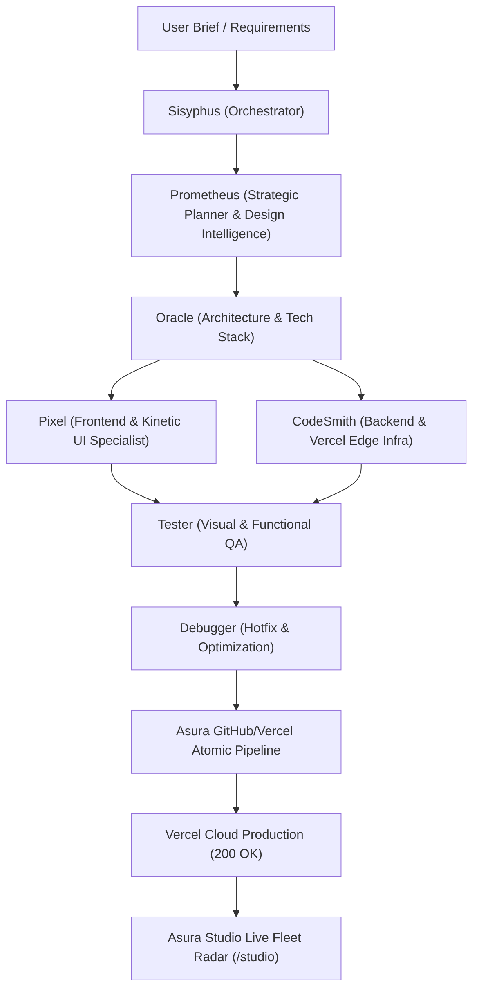

# ASURA // MANUS BUILDER INTEGRATED SYSTEM WORKFLOW
## Autonomous Multi-Agent Web Engineering & Vercel Continuous Deployment

---

### 1. Unified Architecture Overview
The Manus Builder system is now fully integrated as the primary autonomous web engineering engine within the Asura System. All websites designed, developed, and deployed through this workflow follow an uncompromising standard of visual craftsmanship, kinetic motion, and zero-defect Vercel production hosting.

---

### 2. Multi-Agent Team Roster
1. **Sisyphus (Master Orchestrator)**:
   - Directs the lifecycle of every website project from intake to live production.
   - Monitors build milestones, assets, and deployment integrity.
2. **Prometheus (Strategic Planner & Design Intelligence)**:
   - Evaluates client brand identity, market niche, and sensory aesthetics.
   - Uses curated design libraries (`UI/UX Pro Max`, `Design Taste Frontend`) to block generic AI slop.
3. **Oracle (System Architect)**:
   - Designs component boundaries, state flow, and 3D / media canvas pipelines.
   - Ensures cross-platform device responsiveness and zero layout shift.
4. **Pixel (Frontend & Kinetic UI Specialist)**:
   - Authors high-fidelity interactive components using Tailwind CSS, GSAP 3.12, Framer Motion, and HTML5 Canvas.
   - Implements 60fps micro-interactions, folder-tab card cutouts, glassmorphic docks, and bespoke scroll scrubbers.
5. **CodeSmith (Backend & Infrastructure)**:
   - Engineers Vercel serverless functions, asset edge streaming, and zero-404 routing.
   - Manages atomic Git tree commits directly through the GitHub API without shell dependencies.
6. **Tester (QA Specialist)**:
   - Validates live endpoint HTTP status codes, console error logs, and asset loading.
   - Verifies responsiveness on mobile, tablet, and ultra-wide displays.
7. **Debugger (Root Cause Resolver)**:
   - Inspects runtime failures, broken symlinks, syntax errors, and missing assets.
   - Executes immediate precision hotfixes.

---

### 3. Deployed Production Fleet Tracking (Vercel)
The following production applications are active and continuously tracked inside Asura Studio:

| Project Slug | Domain / Client | Tech Stack & Signature Features | Vercel Live Route |
| :--- | :--- | :--- | :--- |
| **`era-residence`** | ERA Residence (Estepona / New Golden Mile) | 3D Pinned Stage, Day/Night Lighting Shift, SVG Hotspot Radar Pins, 3D Perspective Deck, Lenis Momentum Scroll | [`/projects/era-residence`](https://asura-system.vercel.app/projects/era-residence) |
| **`villa-elysee`** | Villa Élysée (Cap de Nice) | 3D AI Clifftop Drone Fly-Through, 60fps Canvas Scrubber, GPS Telemetry, 3D Tilt Cards | [`/projects/villa-elysee`](https://asura-system.vercel.app/projects/villa-elysee) |
| **`aadriti-learning-centre`** | Aadriti Centre For Learning And Psychological Well Being | Folder-Tab Cards, Bento Mosaic, Programs Slider, 1,500+ Metric Counter, Official Client Branding | [`/projects/aadriti-learning-centre`](https://asura-system.vercel.app/projects/aadriti-learning-centre) |
| **`pixnova`** | Pixnova Digital Architecture | Multi-Niche Digital Agency Portfolio, Interactive Dark Blue / White Theme, GSAP Motion | [`/projects/pixnova`](https://asura-system.vercel.app/projects/pixnova) |
| **`studio`** | Asura Control Dashboard | Live Radar Monitor, Autonomous Code Generator, Direct Deployment Manager | [`/studio`](https://asura-system.vercel.app/studio) |

---

### 4. Supreme 3D Animation & Kinetic Inspiration Vault
To eliminate generic AI slop layouts and enforce bespoke 3D scroll kinetics, interactive card physics, and micro-interactions, the Asura / Manus pipeline continuously cross-references these tier-1 motion design resources:

| Platform | Domain | Specialty & Core Architectural Patterns |
| :--- | :--- | :--- |
| **Details.so** | `details.so` | Handpicked luxury & boutique site designs with copyable prompt architectures for precise AI recreation. |
| **Refero.design** | `refero.design` | Real production product screens, comprehensive user flows, and real UX interaction recordings from world-class applications. |
| **Design Spells** | `designspells.com` | Micro-interactions, delightful haptics, cursor physics, and subtle details that make digital experiences feel magical. |
| **Codrops / Tympanus** | `tympanus.net/codrops` | Experimental 3D WebGL card shaders, smooth camera scrubbers, multi-layer depth transitions, and canvas effects. |
| **Awwwards / Site of the Day** | `awwwards.com` | Award-winning interactive luxury real estate, editorial architecture layouts, and kinetic typography. |
| **Godly Website** | `godly.website` | Curated astronomical web design, high-end motion mechanics, and cutting-edge typography. |
| **Hoverstat.es** | `hoverstat.es` | Alternative interaction paradigms, unusual scroll dynamics, and tactile UI components. |
| **Lenis & GSAP ScrollTrigger** | `lenis.darkroom.engineering` | Butter-smooth momentum inertia scrolling, pinned sticky sheet sequences, and perspective card decks. |

---

### 5. Zero-404 Vercel Edge Pipeline
- **Auto-Sync**: Any atomic Git tree push to `main` branch immediately triggers Vercel CI/CD.
- **Dynamic Asset Fallback**: `api/serve_project.js` and `api/serve_asset.js` ensure that all media (videos, WebP frames, photos) resolve with HTTP 200/206 Range streaming without breakage.
- **Studio Fleet Sync**: Asura Studio automatically registers newly deployed projects in its active radar and monitors live status.

